# Lesson 02: User Management & Data Security
**Learning Guide (Student Reference)**

---

## Lesson Objectives

* **Users & Directories** - Local account types, Home Folder hierarchy, and the Shared folder.
* **Secrets Management** - The evolution of passwords, Keychain infrastructure, and the Passwords app from macOS Sequoia through Tahoe.
* **The Passwordless Era & Security Architecture** - Passkeys, POSIX/ACL file permissions, TCC frameworks, and System Integrity Protection (SIP).
* **Enterprise Spice** - Deploying Managed Apple Accounts (MAIDs) and integrating Platform SSO for seamless organizational authentication.

---

## 🎧 Audio Summary — Pre/Post Lesson

<!-- NotebookLM Podcast from Captivate -->

<iframe style="width: 100%; height: 200px;" frameborder="no" scrolling="no" allow="clipboard-write" seamless src="https://player.captivate.fm/episode/4a1fe7a9-1ab4-4499-aada-0e9c8b5d8aec/"></iframe>

---

## Terminology

* **Administrator:** The system administrator account, possessing global permissions to modify system-wide settings and install software for all users.
* **Standard User:** A restricted account, sandboxed primarily to its designated Home Folder (`~`) and personal workspace.
* **Guest User:** A temporary account that automatically purges its entire Home Folder upon logout.
* **Sharing Only:** A lightweight, headless account with no Home Folder, utilized strictly for authenticating against network file shares.
* **Home Folder (`/Users/username`):** The isolated, primary storage directory for an individual user.
* **Shared Folder (`/Users/Shared`):** A public demilitarized zone (DMZ) for local file exchange, protected by the Sticky Bit.
* **Sticky Bit:** A permission flag preventing users from deleting files owned by other users within a shared directory.
* **Keychain:** The native macOS credential management infrastructure, primarily divided into the user's Login Keychain and the global System Keychain.
* **Passwords App:** The centralized macOS 15+ (and enhanced in macOS 26 Tahoe) GUI application for managing passwords, Passkeys, and 2FA tokens.
* **Passkey:** A modern, passwordless authentication standard (FIDO2) utilizing cryptographic key pairs securely stored within the Secure Enclave.

!!! tip "Enterprise Passkeys Framework (5-Stage Model)"
    Transitioning an organization from legacy passwords to secure passwordless authentication (Passkeys) requires a structured approach:
    1. **Assessment & Planning:** Audit existing IT infrastructure and security requirements.
    2. **Solution Selection:** Choose an Identity Provider (IdP) or password manager with full FIDO2 support.
    3. **Testing:** Conduct a controlled deployment with the IT team.
    4. **Full Deployment:** Push Passkey policies globally via Mobile Device Management (MDM).
    5. **Monitoring & Optimization:** Review authentication logs and systematically deprecate legacy passwords.

* **POSIX:** The standard UNIX permission model (Owner, Group, Everyone).
* **ACL (Access Control List):** An advanced, granular permission layer overlaid on top of POSIX.
* **TCC (Transparency, Consent, and Control):** The macOS privacy framework that blocks application access to personal data and hardware (e.g., Camera, Microphone) without explicit user consent.
* **SIP (System Integrity Protection):** A kernel-level defense mechanism locking down core system files and directories, preventing modification even by the `root` user.
* **Managed Apple Account (MAID):** An Apple Account owned, created, and managed by the organization.
* **Platform SSO:** A macOS framework enabling seamless desktop login directly against cloud Identity Providers (IdPs) like Entra ID or Okta.
* **Federated Authentication:** A workflow where entering a corporate email seamlessly redirects the user to their organizational IdP for authentication, eliminating the need for a separate Apple password.

---

---

## Comparing macOS User Account Types

| Account Type | Home Folder (`/Users/`) | System Privileges | Primary Enterprise Use Case |
| :--- | :--- | :--- | :--- |
| **Administrator** | Yes (`/Users/username`) | Global app installation, system-wide settings, and user management | Local IT admin account or elevated power user |
| **Standard** | Yes (`/Users/username`) | Personal settings only; blocked from global system modifications | Recommended default employee account (Least Privilege) |
| **Guest** | Temporary only (wiped on Logout) | Basic browsing/session with zero persistent local storage | Kiosk or loaner stations (disabled into Safari-only mode when FileVault is active) |
| **Sharing Only** | No local home folder | Remote access to shared folders only (cannot log in locally) | Controlled SMB file-sharing access to specific Shared folders |

!!! warning "Common Field Issue: Login Keychain Password Desync"
    When a user's login password is reset externally (by an IT admin, an IdP sync, or from Recovery Mode), the macOS account login password updates—but the **Login Keychain** remains encrypted with the old password. Result: endless pop-ups asking to unlock the `login` keychain!
    * **If the user remembers the old password:** Update the keychain password in `Keychain Access` (`Edit > Change Password for Keychain "login"`).
    * **If the old password is completely lost:** Reset the keychain in `Keychain Access` settings (`Reset Default Keychains`), creating a fresh Login Keychain encrypted with the new password (archiving the old local keychain).

---

## The Four Permission & Security Layers (POSIX, ACL, TCC, SIP)

| Layer | What Does It Check? | Enforcement Scope | Inspection / Management Tool |
| :--- | :--- | :--- | :--- |
| **1. POSIX** | Classic UNIX ownership: `Owner`, `Group`, `Everyone` (Read/Write/Execute) | User & Primary Group | Finder `Get Info` or `ls -la` / `chmod` |
| **2. ACL** | Granular rules layered above POSIX (including explicit `Deny` & inheritance) | Multiple specific users/groups | `ls -le` / `chmod +a` |
| **3. TCC** | Did the user explicitly allow this specific app to access sensitive folders or hardware? | Per-Application (blocks Admins too!) | `System Settings > Privacy & Security` / `tccutil` / PPPC |
| **4. SIP** | Does the file belong to protected macOS system paths? | Kernel-level (blocks `root` too!) | `csrutil status` (modifiable only from Recovery) |

---

## CLI Commands

!!! note "Terminal Usage"
    The CLI commands listed here are for demonstration purposes. There is no need to memorize their syntax at this stage! You can simply copy-paste them during the lab to observe the output. We will dive deep into Terminal workflows in Lesson 08, and explore the unified logging system in Lesson 16. For now, treat the Terminal purely as a quick diagnostic tool.

| Command | Description |
|---|---|
| `dscl . -list /Users` | List all local user accounts on the system |
| `dscl . -read /Users/username` | Read extended properties and attributes of a specific user |
| `ls -la /Users` | Display file permissions, including identifying the Sticky Bit (`t`) |
| `ls -le /path` | Display file permissions, including ACL records (`+`) |
| `security list-keychains` | Display the list of currently active Keychains |
| `log show --predicate 'subsystem == "com.apple.PlatformSSO"'` | Search for Platform SSO authentication errors within system logs |

---

## Recommended Reading

* [Intro to user account types](https://support.apple.com/guide/platform-support/sup72e8c67c3/web) - Official Apple Platform Support guide.
* [About Managed Apple Accounts](https://support.apple.com/guide/deployment/depdc4ba8d82/web) - Managing MAIDs in the enterprise.
* [Explainer: Keychain basics](https://eclecticlight.co/2022/10/15/explainer-keychain-basics/) - An in-depth architectural look at Keychain.

---

## 🎬 Video Summary

<!-- YouTube Video Summary -->

    <iframe width="100%" height="450" src="https://www.youtube.com/embed/S1n1JS-mWTM" frameborder="0" allow="accelerometer; autoplay; clipboard-write; encrypted-media; gyroscope; picture-in-picture" allowfullscreen></iframe>

---

## Visual Aids

!!! tip "Visual Demonstration (Student Aid)"
    These images illustrate the relevant interface or mechanism for the lesson topic.

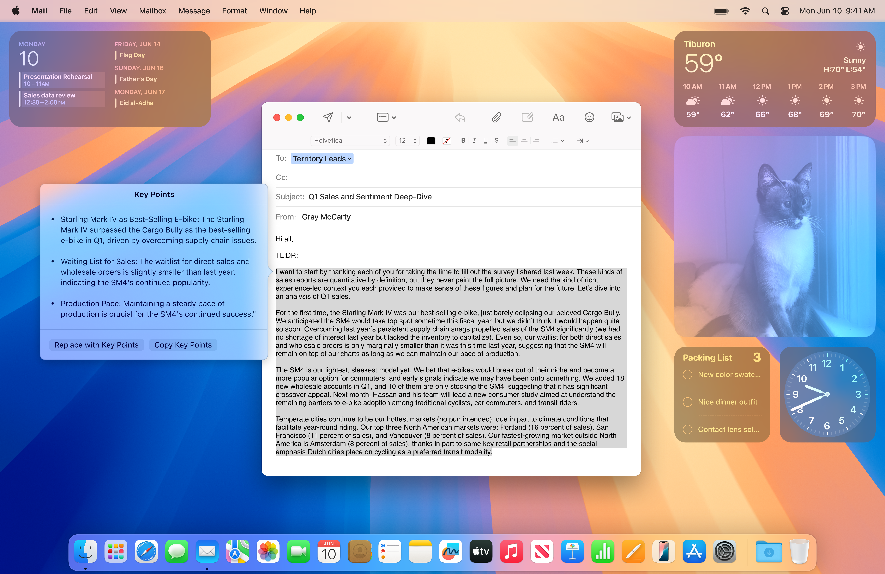
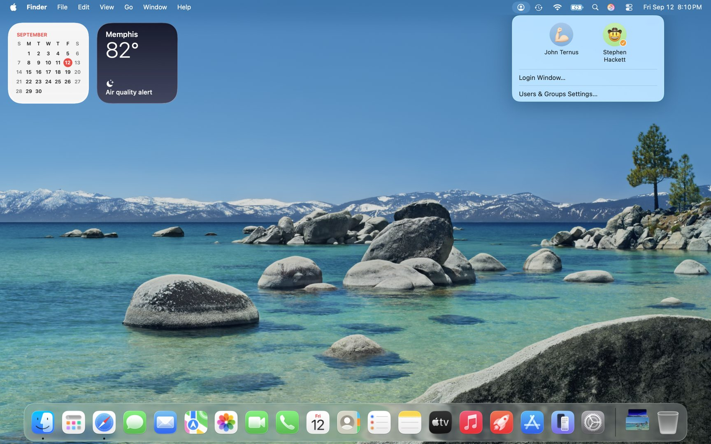
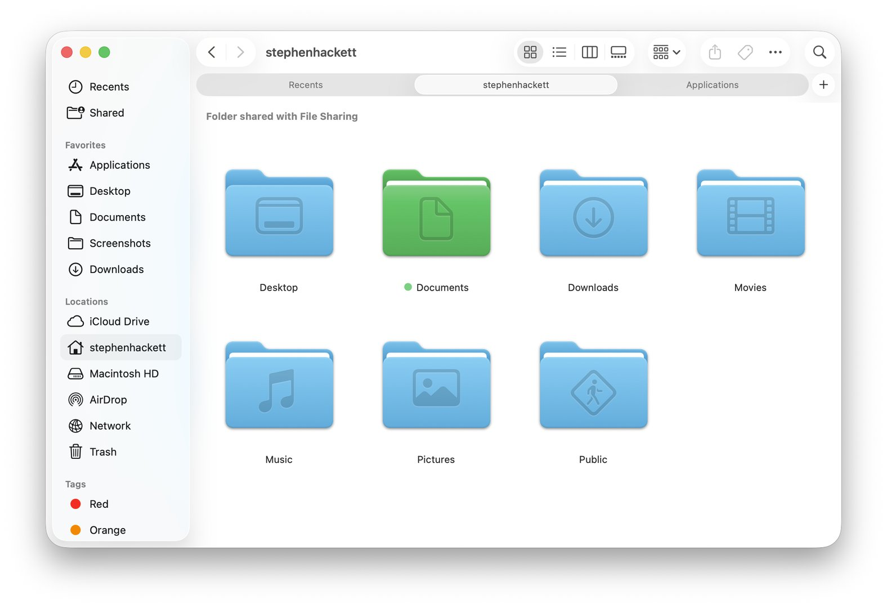
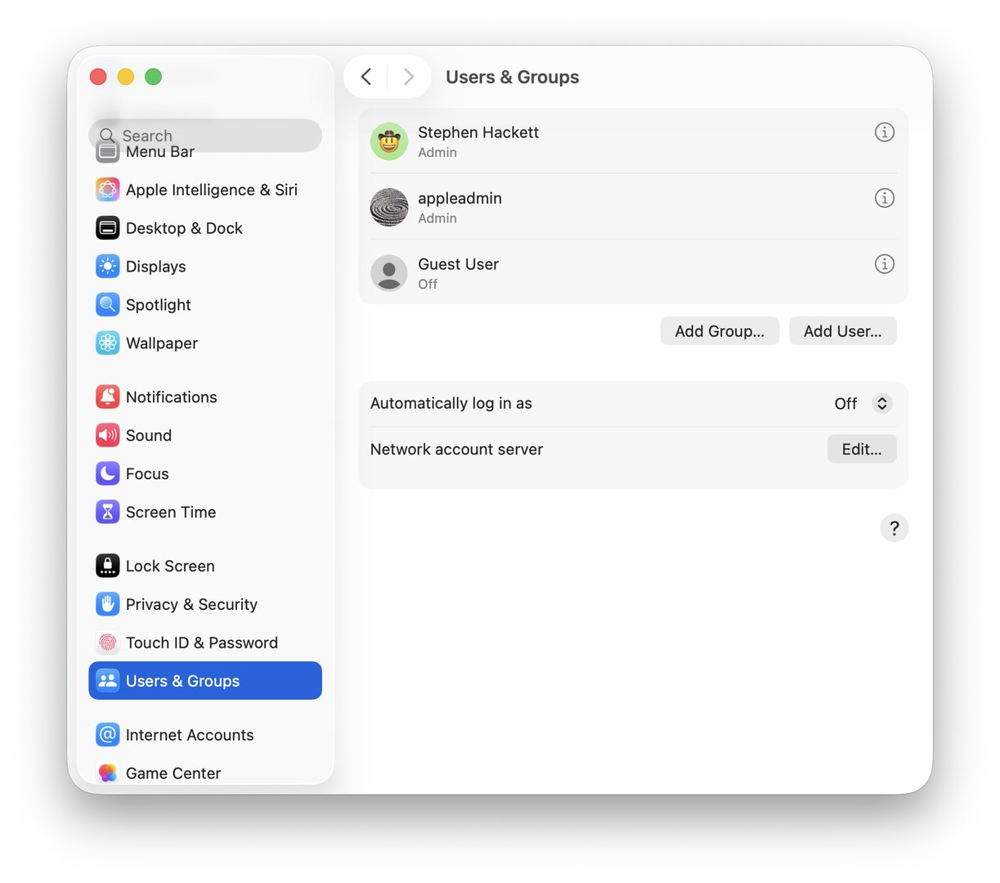
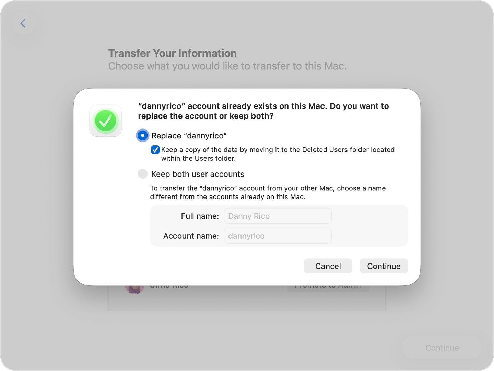
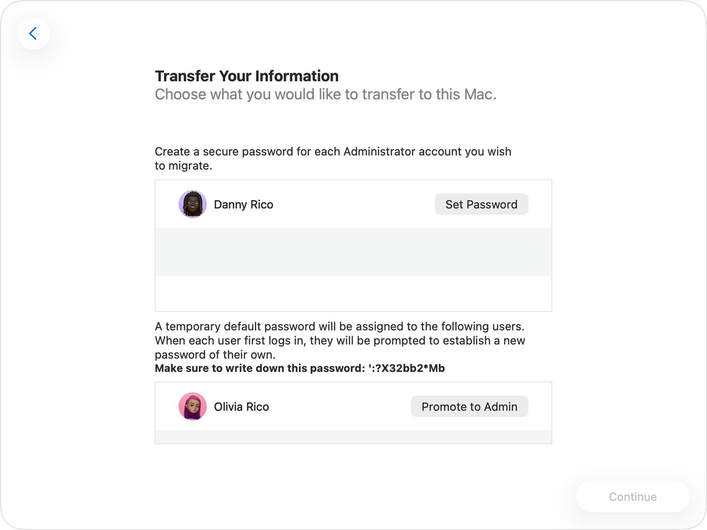
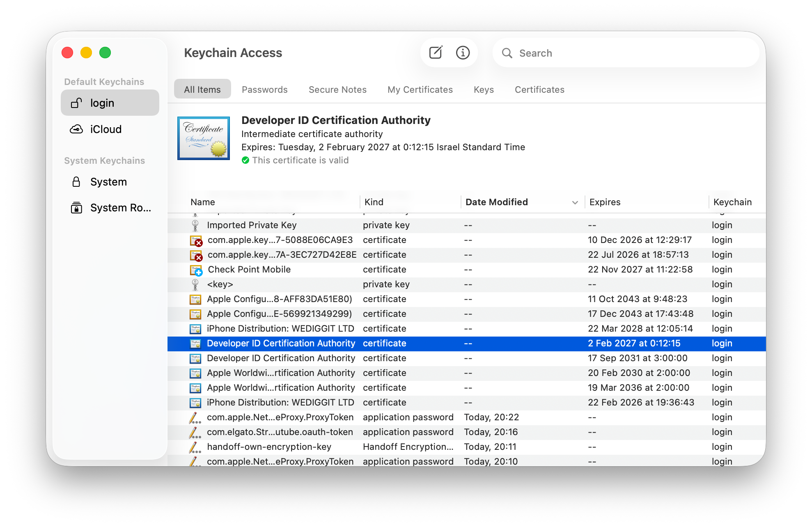
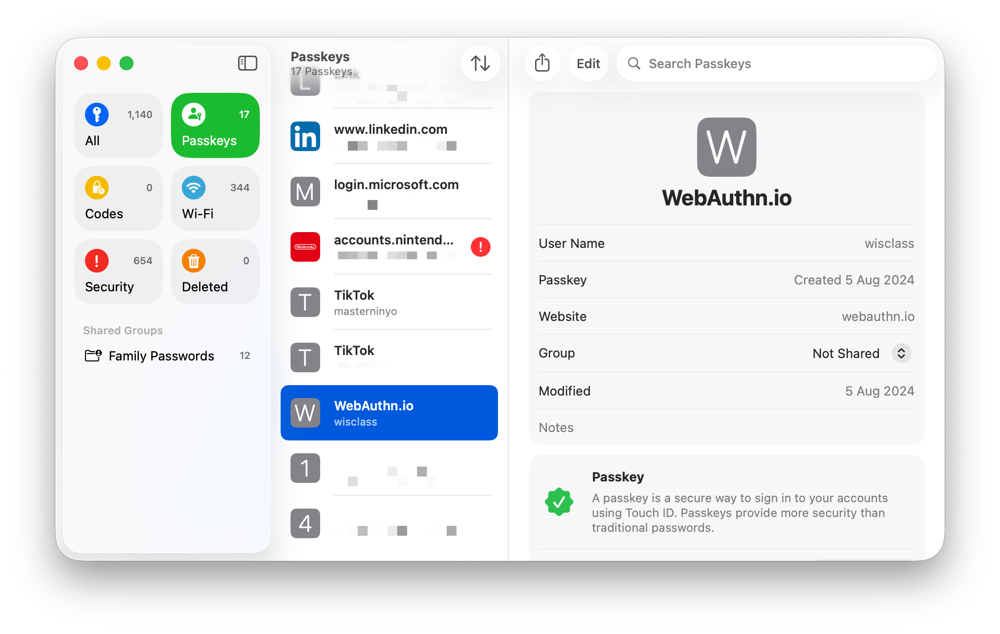
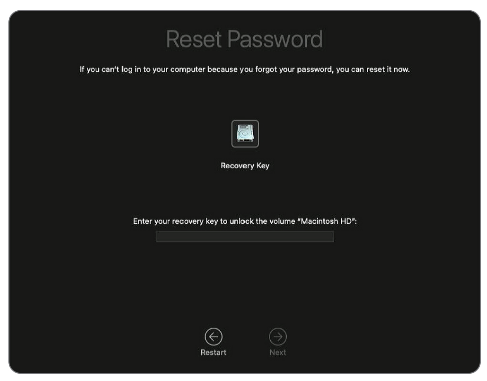
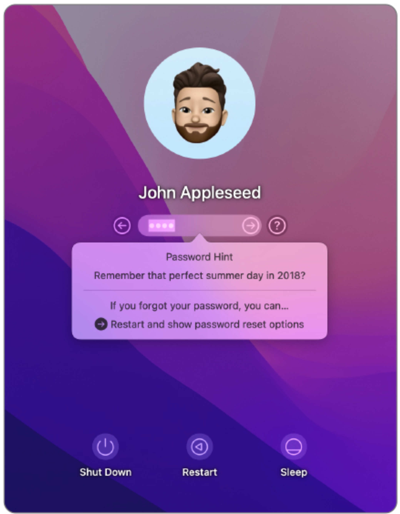
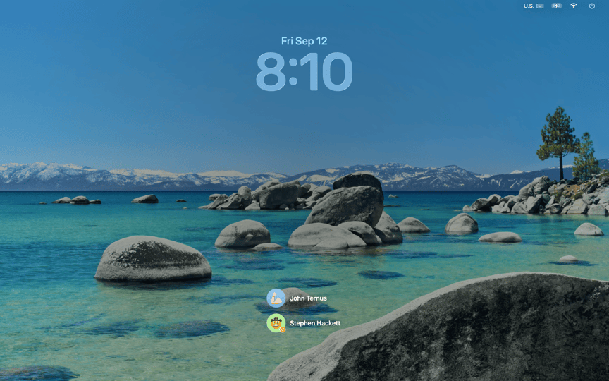
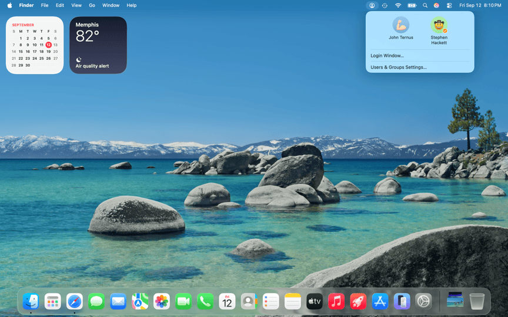
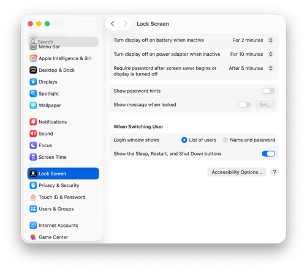
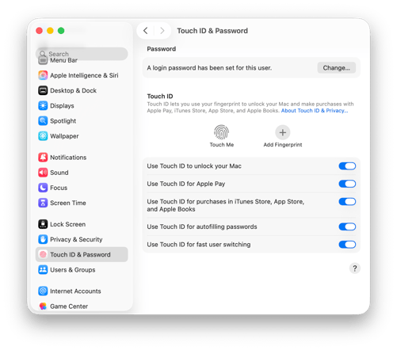
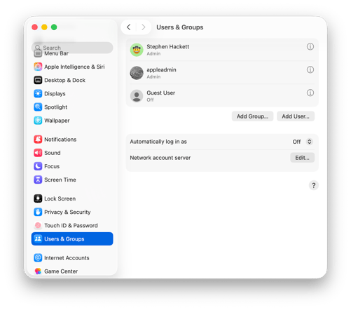

<!-- src_hash: 3c6a261ba8b2451fc2ee9a3975e8dfbdc1a7c0b5f712af76a6e0053fd66a9ac4 -->
