# שיעור 02: ניהול משתמשים ואבטחת נתונים
**מדריך עזר לתלמיד**

---

## מטרות השיעור

* **משתמשים ותיקיות** - סוגי חשבונות מקומיים, היררכיית ה-Home Folder ותיקיית Shared.
* **ניהול סודות** - אבולוציית הסיסמאות, Keychain, ואפליקציית Passwords מ-macOS Sequoia ו-Tahoe.
* **העידן ללא סיסמה ואבטחה** - Passkeys והרשאות קבצים (POSIX/ACL), מערכת TCC ו-SIP.
* **תיבול ארגוני** - עבודה עם Managed Apple Accounts (MAID) ושילוב Platform SSO לכניסה שקופה בארגון.

---

## 🎧 האזנה לסיכום — לפני או אחרי השיעור

<!-- פודקאסט NotebookLM מתוך Captivate -->

<iframe style="width: 100%; height: 200px;" frameborder="no" scrolling="no" allow="clipboard-write" seamless src="https://player.captivate.fm/episode/4a1fe7a9-1ab4-4499-aada-0e9c8b5d8aec/"></iframe>

---

## מושגי מפתח (Terminology)

* **מנהל מערכת (Administrator):** משתמש מנהל המערכת, בעל הרשאות גלובליות לשנות הגדרות ולהתקין תוכנות לכולם.
* **משתמש רגיל (Standard) User:** משתמש רגיל, מוגבל לתיקיית הבית שלו (`~`) ולמרחב האישי שלו.
* **Guest User:** משתמש אורח, מוחק את כל תוכן התיקיה שלו בניתוק.
* **Sharing Only:** משתמש נטול תיקיית בית שנועד אך ורק להזדהות מול שיתופי רשת.
* **Home Folder (`/Users/username`):** תיקיית הבית המבודדת של המשתמש.
* **Shared Folder (`/Users/Shared`):** אזור מפורז ציבורי. מוגן באמצעות Sticky Bit.
* **Sticky Bit:** דגל הרשאה המונע ממשתמשים למחוק קבצים השייכים למשתמשים אחרים באותה תיקיה.
* **Keychain:** תשתית מחזיק המפתחות של macOS, מורכבת מ-Login Keychain ו-System Keychain.
* **Passwords app:** האפליקציה המרכזית (מ-macOS 15 ומשופרת ב-macOS 26 Tahoe) לניהול סיסמאות, Passkeys וקודי 2FA.
* **Passkey (מפתח גישה):** תקן הזדהות (FIDO2) ללא סיסמה באמצעות צמד מפתחות קריפטוגרפי ב-Secure Enclave.

!!! tip "מודל 5 השלבים להטמעת Passkeys בארגון (Enterprise Passkeys Framework)"
    כאשר ארגון עובר מסיסמאות מסורתיות להזדהות מאובטחת ללא סיסמה (Passkeys), ההטמעה מתבצעת ב-5 שלבים מובנים:
    1. **Assessment & Planning:** מיפוי מערכות ה-IT ודרישות אבטחה בארגון.
    2. **Solution Selection:** בחירת מנהל סיסמאות/זהויות (IdP) התומך בתקני FIDO2.
    3. **Pilot & Testing:** ניסוי מבוקר עם קבוצת IT.
    4. **Full Deployment:** דחיפת מדיניות דרך ה-MDM.
    5. **Monitoring & Optimization:** סקירת לוגים וביטול סיסמאות.

* **POSIX:** מודל ההרשאות הסטנדרטי של UNIX (Owner, Group, Everyone).
* **ACL (Access Control List):** שכבת הרשאות מתקדמת וגרגולרית המתווספת מעל POSIX.
* **TCC (Transparency, Consent, and Control):** מנגנון פרטיות החוסם גישה של אפליקציות לקבצים אישיים ולחומרה (כמו מצלמה) אלא אם המשתמש נתן אישור מפורש.
* **SIP (System Integrity Protection):** מגן על קבצי ליבה של המערכת מפני שינויים, אפילו עקרונית על ידי ה-root.
* **Managed Apple Account (MAID):** חשבון Apple בבעלות הארגון.
* **Platform SSO:** תשתית ב-macOS המאפשרת התחברות למחשב ישירות מול שרת זהויות ענן (IdP) כדוגמת Entra ID או Okta.
* **Federated Authentication:** מצב בו הזנת אימייל ארגוני מעבירה את המשתמש להזדהות מול שרת החברה, מבלי לדרוש סיסמת Apple.

> *← בשיעור 03 (אבטחת מידע) נעמיק במנגנון ה-TCC ובאופן שבו מנהלי IT מאשרים הרשאות פרטיות מראש באמצעות פרופילי PPPC ב-MDM.*
> *← בשיעור 04 (הצפנה ומפתחות) נלמד כיצד הרשאות המשתמש המקומי מתרגמות לבעלות קריפטוגרפית (Secure Token) ולפתיחת הצפנת FileVault.*
> *← בשיעור 06 (מערכת הקבצים APFS) נרחיב על תיקיית ה-Home Folder כחלק מארבעת מרחבי המערכת (Domains) וכיצד כונן המערכת המוגן (SSV) מחליף חלק מתפקידי ה-SIP הקלאסיים.*

---

## השוואת סוגי חשבונות ב-macOS

| סוג חשבון | תיקיית בית (`/Users/`) | הרשאות מערכת | שימוש מרכזי בארגון |
| :--- | :--- | :--- | :--- |
| **Administrator (מנהל)** | כן (`/Users/username`) | התקנת תוכנות גלובלית, שינוי הגדרות מערכת וניהול משתמשים | חשבון IT מקומי או משתמש עם הרשאות מוגברות |
| **Standard (רגיל)** | כן (`/Users/username`) | שינוי הגדרות אישיות בלבד; חסום משינויי מערכת גלובליים | חשבון ברירת המחדל המומלץ לעובדים (Least Privilege) |
| **Guest (אורח)** | זמנית בלבד (נמחקת ב-Logout) | גלישה ושימוש בסיסי ללא שמירת מידע קבוע | עמדות קיוסק או השאלה זמנית (מושבת אוטומטית אם FileVault דולק ללא הגדרת Safari-only) |
| **Sharing Only (שיתוף בלבד)** | ללא תיקיית בית מקומית | גישה מרחוק לתיקיות משותפות בלבד (ללא יכולת Login מקומי) | גישת SMB מבוקרת לקבצים ספציפיים בתיקיית Shared |

!!! warning "תקלת שטח נפוצה: חוסר סנכרון של ה-Login Keychain"
    כאשר סיסמת המשתמש מאופסת מבחוץ (למשל על ידי מנהל IT, דרך שרת ה-IdP או ממצב Recovery), סיסמת ההתחברות למק מתעדכנת — אך ה-**Login Keychain** נשאר נעול עם הסיסמה הישנה. התוצאה: חלוניות קופצות חוזרות ונשנות המבקשות את סיסמת ה-Keychain לאחר הכניסה.
    **הפתרון:**
    1. אם המשתמש **זוכר את הסיסמה הישנה**: פתיחת אפליקציית `Keychain Access` ← בחירה ב-`login` ← תפריט `Edit` ← בחירה ב-`Change Password for Keychain "login"` והזנת הסיסמה הישנה ולאחריה החדשה.
    2. אם הסיסמה הישנה **אבדה לחלוטין**: איפוס מחזיק המפתחות דרך הגדרות `Keychain Access` (`Reset Default Keychains`) — פעולה שיוצרת Login Keychain חדש ונקי תחת הסיסמה החדשה (הסיסמאות המקומיות הישנות יאורכבו).

---

## ארבע שכבות ההרשאה והאבטחה (POSIX, ACL, TCC, SIP)

| שכבה | מה היא בודקת? | רמת אכיפה | כלי בדיקה / ניהול |
| :--- | :--- | :--- | :--- |
| **1. POSIX** | בעלות קלאסית: `Owner`, `Group`, `Everyone` (קריאה/כתיבה/הרצה) | משתמש וקבוצה | חלון `Get Info` ב-Finder או `ls -la` / `chmod` |
| **2. ACL** | חוקים פרטניים מעבר ל-POSIX (כולל הרשאות `Deny` וירושה) | משתמשים מרובים | `ls -le` / `chmod +a` |
| **3. TCC** | האם המשתמש אישר לאפליקציה הספציפית לגשת לתיקייה רגישה או לחומרה? | פר-אפליקציה (אפילו ל-Admin!) | `System Settings > Privacy & Security` / `tccutil` / PPPC |
| **4. SIP** | האם הקובץ שייך לליבת המערכת המוגנת? | קרנל (חוסם גם `root`) | `csrutil status` (ניתן לשינוי מ-Recovery בלבד) |

---

## פקודות שימושיות (CLI Commands)

!!! note "שימוש בטרמינל (שורת הפקודה)"
    מופיעות כאן פקודות טרמינל שאנו מדגימים בשיעור. אין צורך לזכור את התחביר שלהן בעל פה כעת! ניתן פשוט לבצע העתק-הדבק במעבדה כדי לקבל את התוצאה. הלימוד המעמיק של הטרמינל יתבצע באופן מסודר בשיעור 08, ולאחר מכן נלמד על מערכת הלוגים בשיעור 16. בינתיים, השתמשו בזה ככלי בדיקה מהיר בלבד.

| פקודה | תיאור |
|---|---|
| `dscl . -list /Users` | הצגת רשימת כלל המשתמשים במערכת (לוקאליים) |
| `dscl . -read /Users/username` | קריאת מאפיינים נרחבים של משתמש ספציפי |
| `ls -la /Users` | הצגת הרשאות קבצים, כולל זיהוי ה-Sticky Bit (`t`) |
| `ls -le /path` | הצגת הרשאות קבצים, כולל תצוגת רשומות ACL (`+`) |
| `security list-keychains` | הצגת רשימת מחזיקי המפתחות הפעילים כעת |
| `log show --predicate 'subsystem == "com.apple.PlatformSSO"'` | חיפוש שגיאות התחברות מול שרתי SSO בלוגים |

---

## קישורים מומלצים ולקריאה נוספת

* [Intro to user account types](https://support.apple.com/guide/platform-support/sup72e8c67c3/web) - מדריך תמיכה רשמי של אפל.
* [About Managed Apple Accounts](https://support.apple.com/guide/deployment/depdc4ba8d82/web) - ניהול MAID בארגון.
* [Explainer: Keychain basics](https://eclecticlight.co/2022/10/15/explainer-keychain-basics/) - מאמר עומק על Keychain.

---

## 🎬 סרטון סיכום

<!-- סרטון סיכום מתוך YouTube -->

    <iframe width="100%" height="450" src="https://www.youtube.com/embed/S1n1JS-mWTM" frameborder="0" allow="accelerometer; autoplay; clipboard-write; encrypted-media; gyroscope; picture-in-picture" allowfullscreen></iframe>

---

## עזרים ויזואליים

!!! tip "המחשה ויזואלית (עזר לתלמיד)"
    תמונות אלו ממחישות את הממשק או המנגנון הרלוונטי לנושא השיעור.

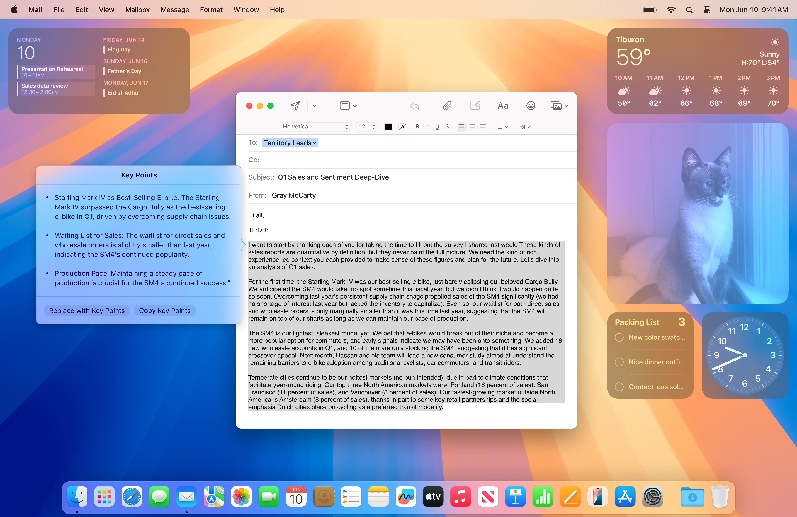
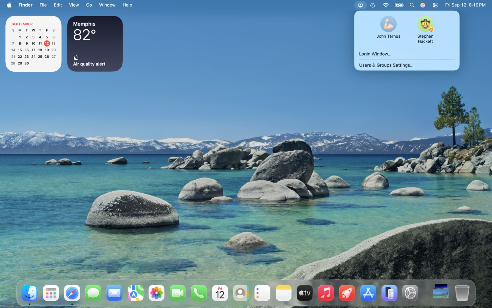
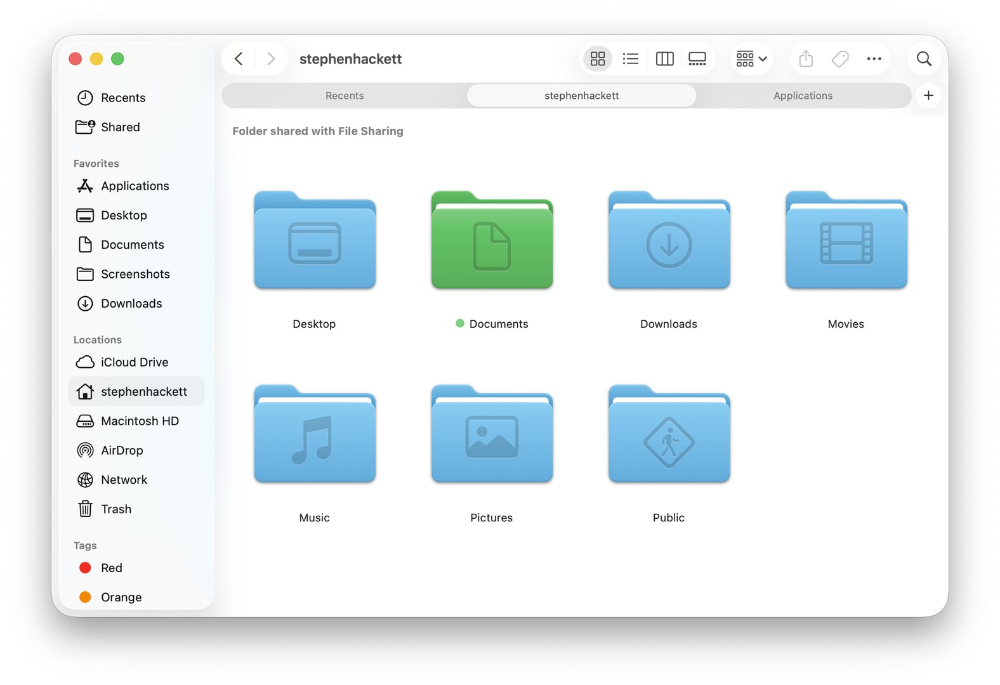
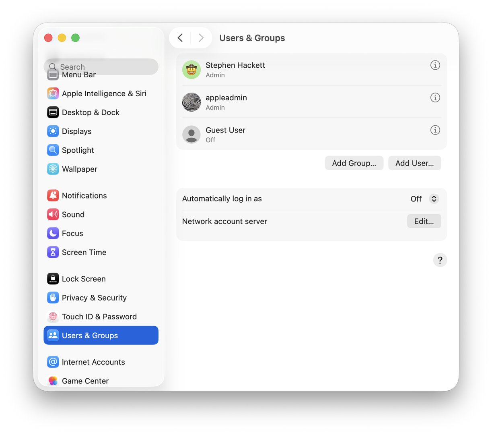
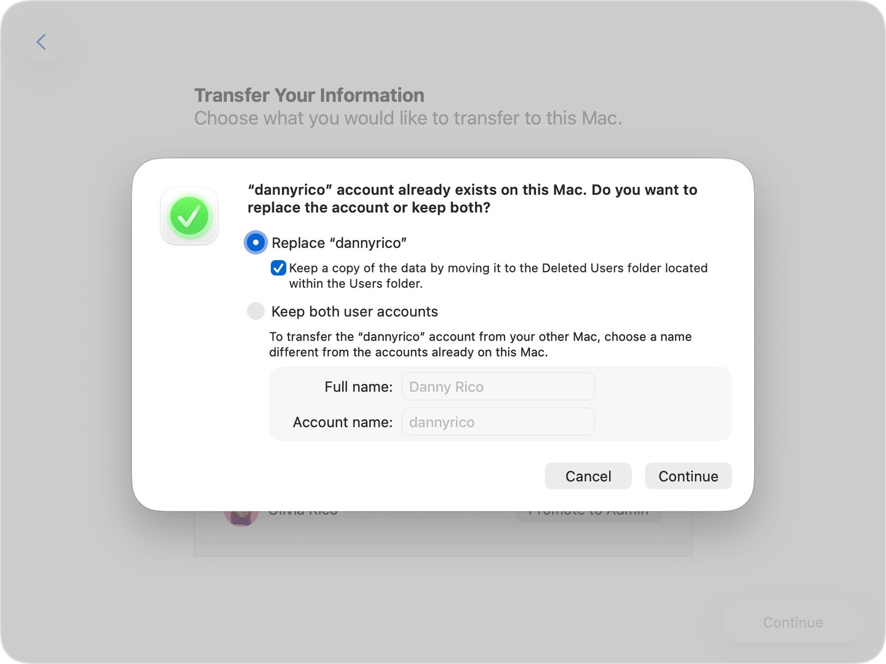
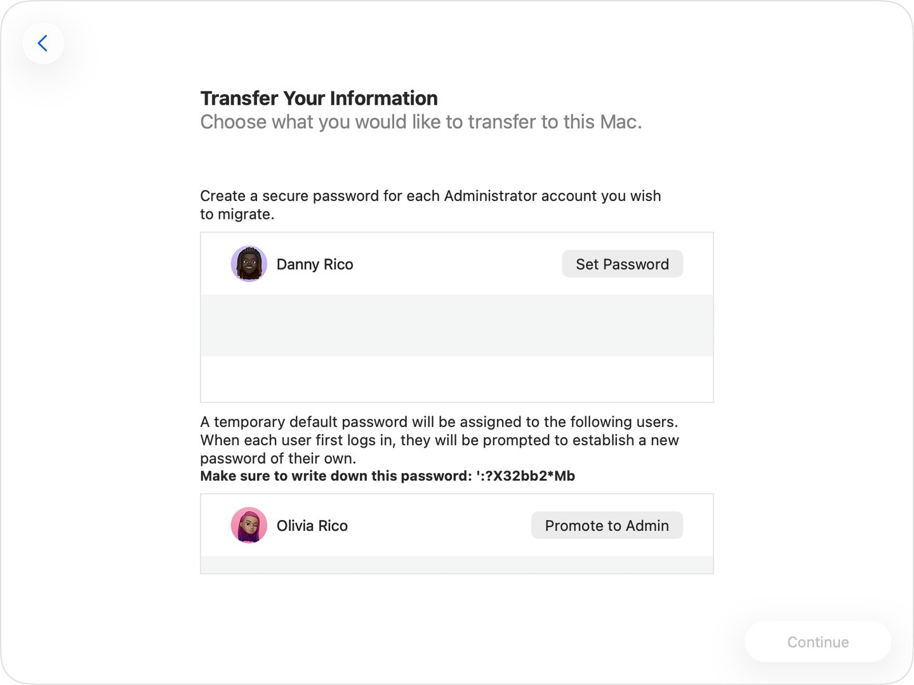
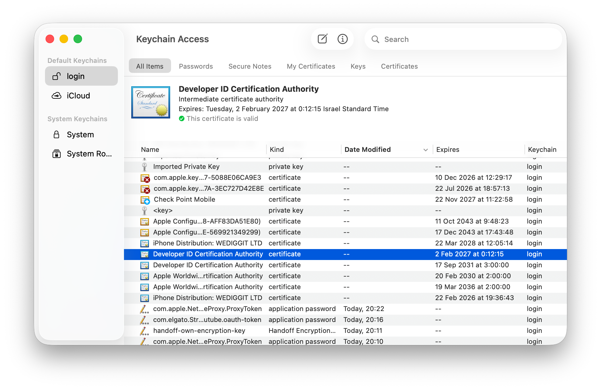
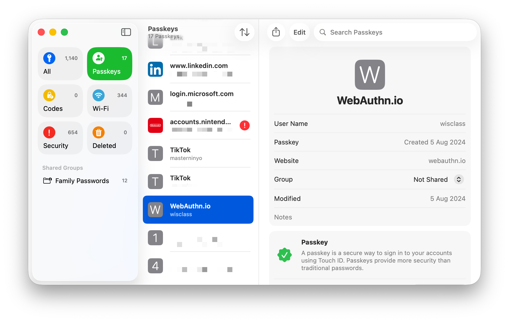
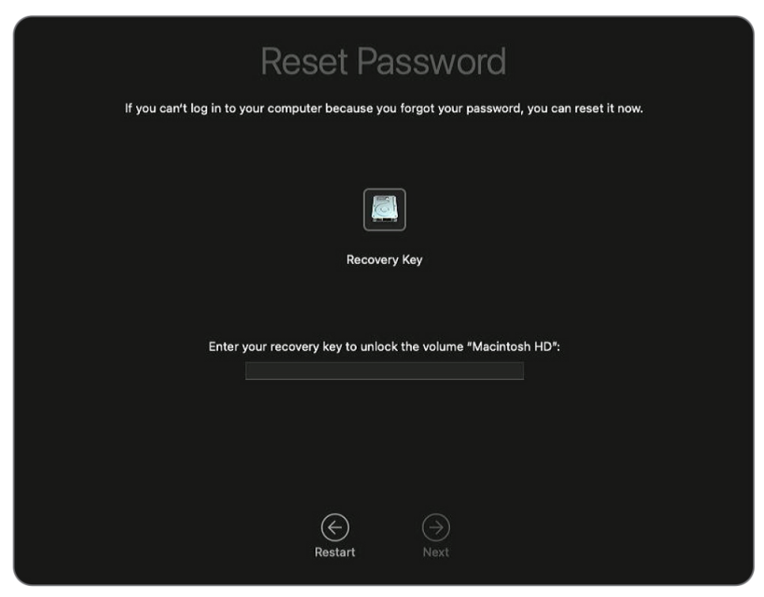
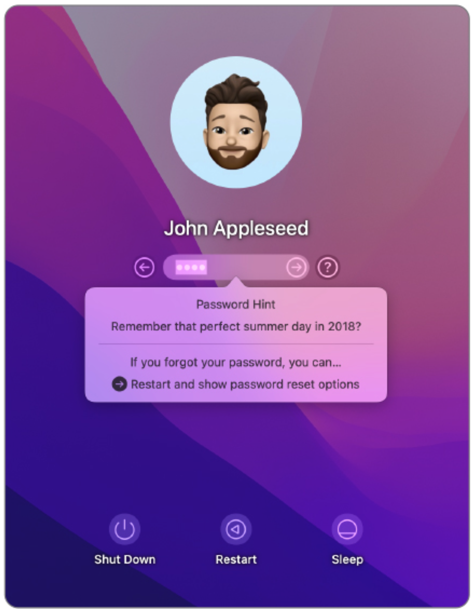
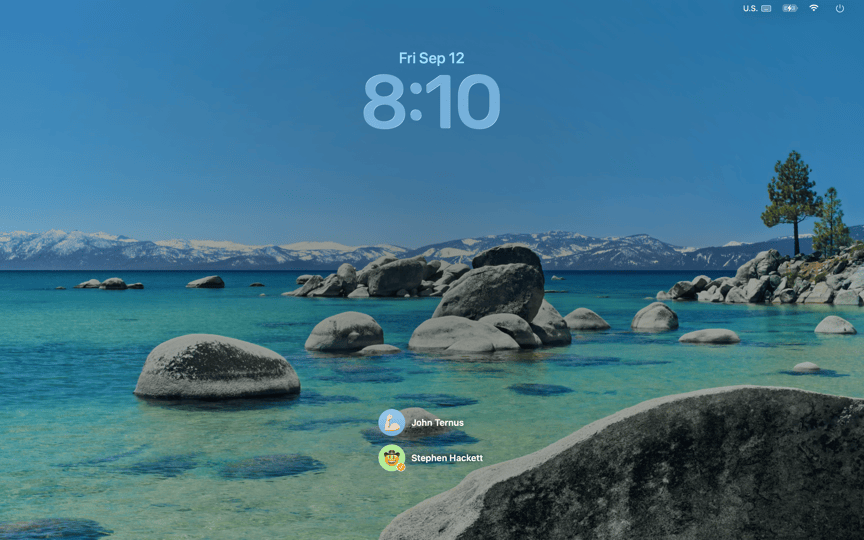
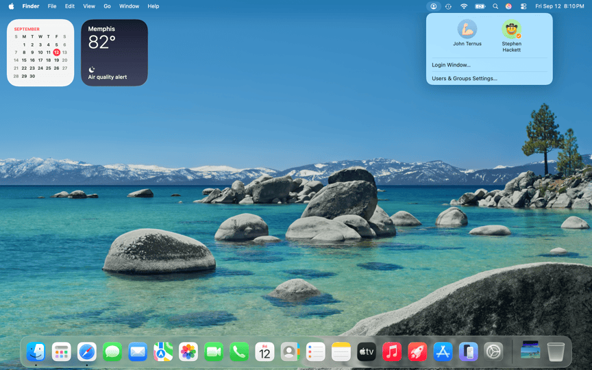
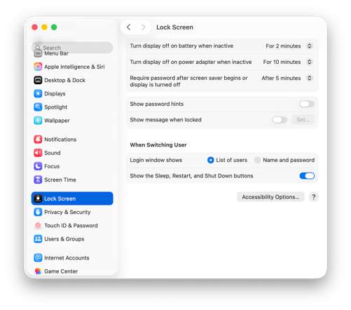
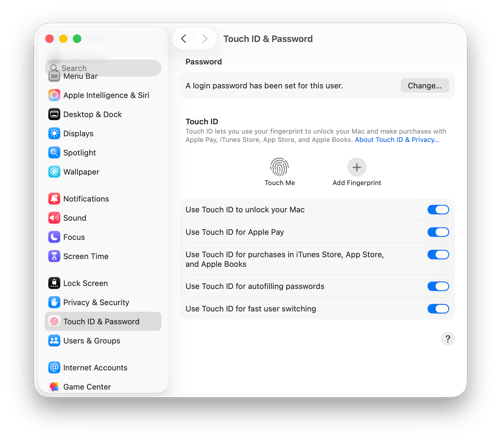
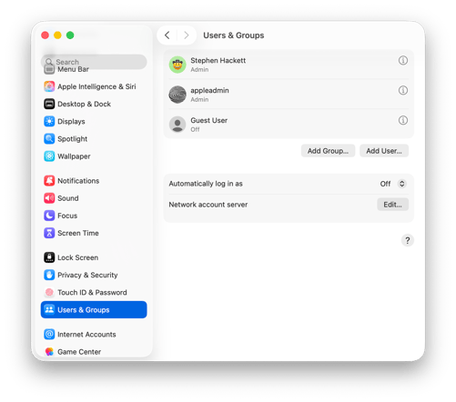
