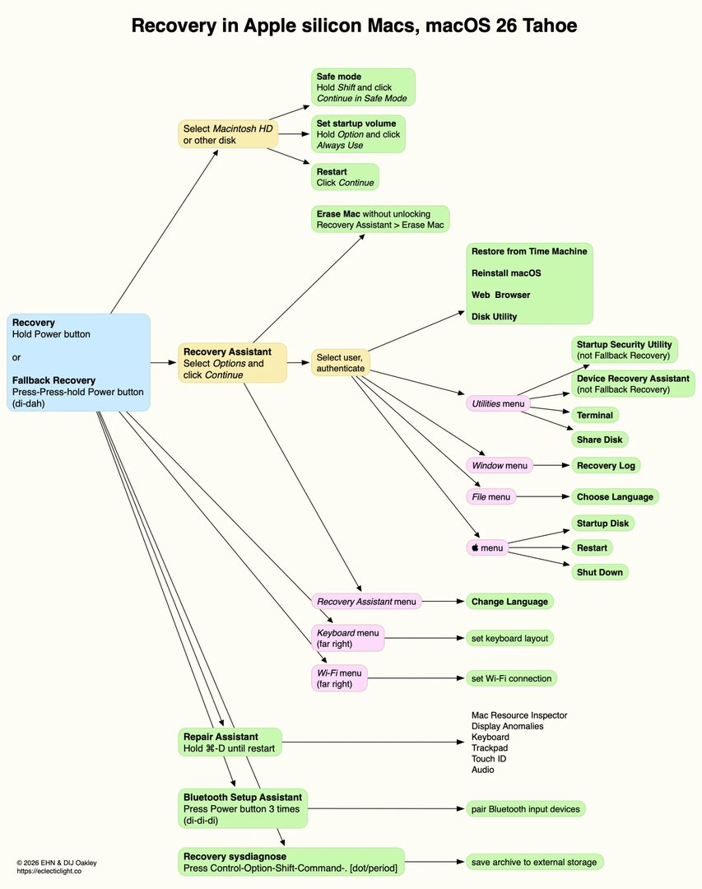
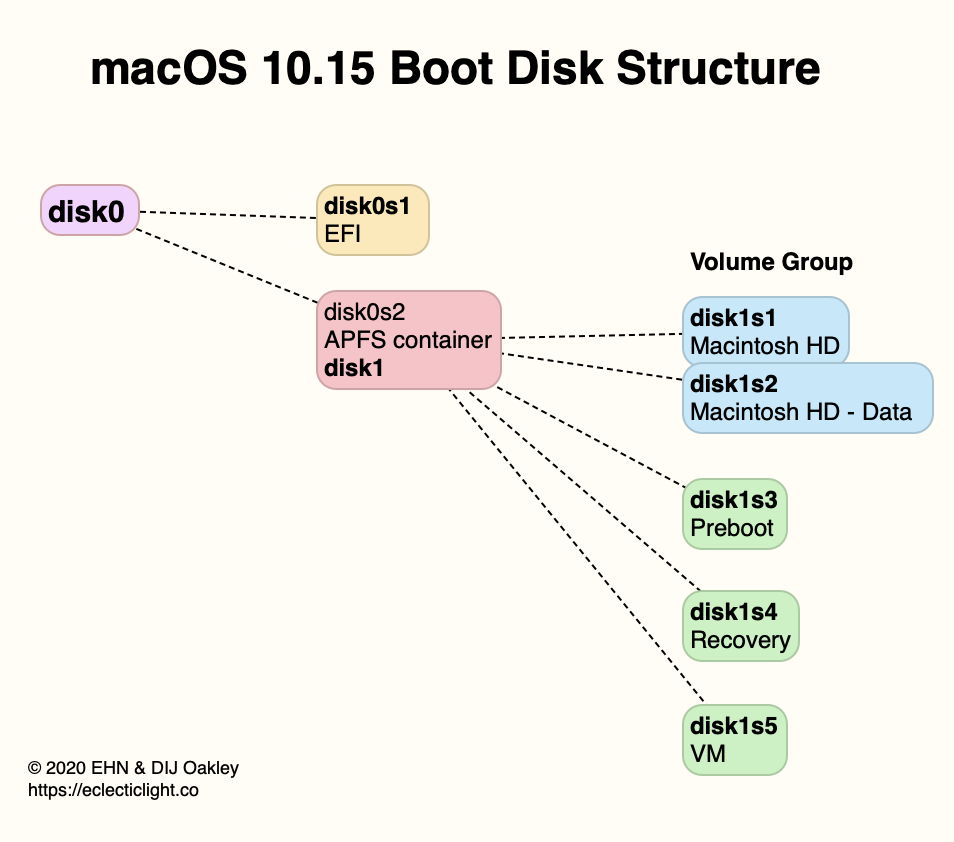
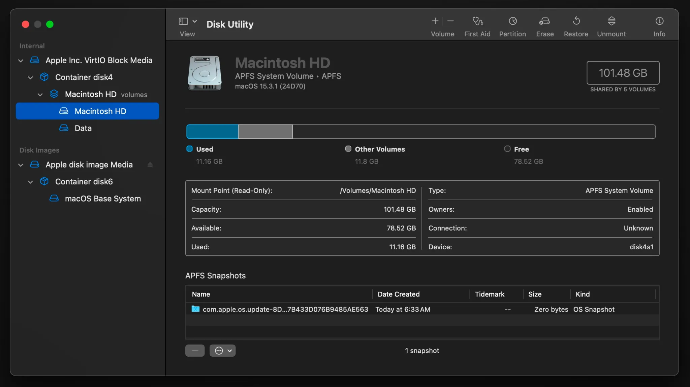
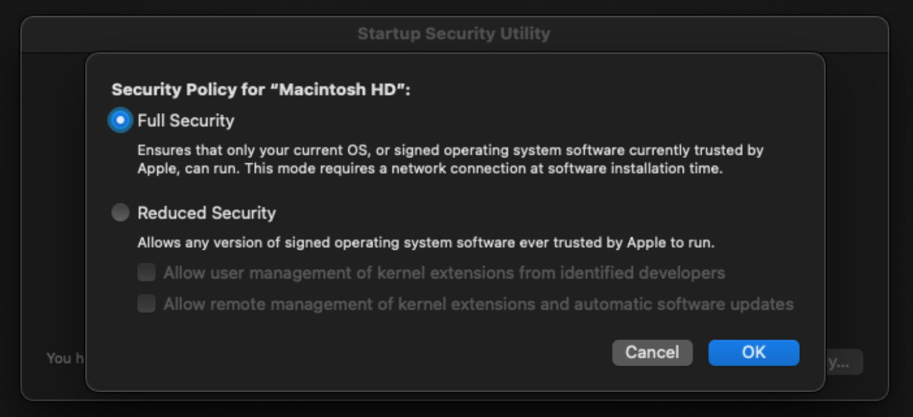

# Lesson 14: System Recovery & Erasure
**Part C: Learning Guide**

## Lesson Objectives

* **Apple Silicon Recovery Architecture** - Distinguish primary `1TR` (One True Recovery), `Fallback Recovery (frOS)`, and automated `Device Recovery Assistant (DRA)`.
* **RecoveryOS Tooling** - Operate `Recovery Assistant`, `Disk Utility`, `Share Disk`, `resetpassword`, and `recoverydiagnose`.
* **Cryptographic Erasure & Lock Management** - Execute `Erase All Content and Settings (EACS)` safely and resolve `Activation Lock` / `Recovery Lock` in enterprise fleets.
* **Hardware-Level DFU Servicing** - Perform `Revive` (non-destructive) vs. `Restore` (full wipe) over USB-C.

---

## Overview

<!-- NotebookLM Podcast from Captivate -->

<iframe style="width: 100%; height: 200px;" frameborder="no" scrolling="no" allow="clipboard-write" seamless src="https://player.captivate.fm/episode/0b72cae7-af65-4c30-bf48-1086a4744e98/"></iframe>

## Core Recovery Concepts

*   **1TR (One True Recovery):** On Apple Silicon Macs, the recovery environment (RecoveryOS) is completely isolated from the standard operating system and stored in a dedicated container. It is architected to be resilient — even if you completely wipe the disk, 1TR survives to enable reinstallation.
*   **Fallback Recovery (frOS):** The backup recovery mechanism on Apple Silicon. If 1TR fails, the Mac boots a minimal fallback recovery image. Triggered by a quick double-press and hold ("di-dah") of the Power button.
*   **Device Recovery Assistant (DRA) [New in Tahoe]:** An automated triage tool marked with a ⊕ symbol that launches automatically during boot failures to unlock FileVault and repair filesystem structures.
*   **DFU Mode (Device Firmware Update):** Lowest-level hardware recovery mode for catastrophic failures. Requires a secondary Mac, USB-C cable, and Apple Configurator to perform Revive or Restore operations.
*   **EACS (Erase All Content and Settings):** Fast, secure erasure via Crypto-shredding. Obliterating the Volume Encryption Key (VEK) inside the Secure Enclave renders storage instantly unreadable without zero-filling SSD flash cells.
*   **Activation Lock:** Anti-theft mechanism tied to Apple Account via Find My. Following an erase, the Mac cannot be activated without the original account credentials or an MDM Bypass Code.
*   **Recovery Assistant:** The initial interface encountered in Recovery. Authenticates identity against the Secure Enclave (user password) to unlock the encrypted Data volume.
*   **Share Disk:** Replaces legacy Target Disk Mode on Apple Silicon. Enables sharing the Mac storage over physical Thunderbolt or network connections via SMB protocol.

> *← The boot chain leading to 1TR was covered in Lesson 13 (Boot Process) — here we focus on actions taken within the recovery interface.*
> *← VEK and FileVault were covered in Lesson 04 (Encryption) — EACS leverages that same VEK to destroy encryption keys rather than overwriting sectors.*

---

## Comparing Apple Silicon Recovery Environments

| Recovery Environment | How to Enter / Trigger | Where Does It Live? | Primary Use Case |
| :--- | :--- | :--- | :--- |
| **1TR (One True Recovery)** | Press and hold Power button (`Continue holding for startup options`) | Primary Recovery container on internal SSD | Password reset, Disk Utility, macOS reinstall, or modifying `Startup Security Utility` |
| **Fallback Recovery (frOS)** | Double-press Power button and hold on second press (`Di-dah`) | Dedicated backup container (`Apple_APFS_Recovery`) | Emergency fallback when primary `1TR` is corrupted (Note: omits `Startup Security Utility`) |
| **Device Recovery Assistant (DRA)** | Launches automatically (`⊕` symbol) upon repeated boot failure in macOS 26 Tahoe | Automated recovery assistant inside RecoveryOS | Automated filesystem repair or FileVault recovery without technician intervention |
| **DFU Mode (Hardware)** | Dedicated key chord / Power press while connected via USB-C to the DFU port | Hardware BootROM inside the Apple Silicon SoC | Completely unresponsive Mac (black screen / amber exclamation mark) when `frOS` cannot boot |

---

## DFU Revive vs. Restore

| Attribute | **Revive** — Always Try First! | **Restore** — Last Resort! |
| :--- | :--- | :--- |
| **What Does It Update?** | Refreshes system firmware (`iBoot`/SEP) and the `1TR` Recovery partition only | Flashes firmware, formats the entire internal SSD, and installs a clean macOS |
| **User Data Impact** | **100% Preserved!** Leaves the `Data` volume intact | **100% Erased!** Cryptographically destroys all containers |
| **When to Use?** | Power loss mid-update, black screen after update, or blinking status LED | When `Revive` fails, or when reprovisioning a Mac that requires a full factory wipe |

---

## Terminal Commands in Recovery

In Recovery Mode, Terminal provides low-level diagnostic capabilities.

### Disk & Filesystem Management – `diskutil`

*   `diskutil list`: Displays all physical and logical disks, including hidden partitions like 1TR.
*   `diskutil apfs list`: Detailed breakdown of APFS containers, volumes, and encryption states.

### Diagnostics & Passwords

*   `resetpassword`: Launches the graphical password reset assistant.
*   `recoverydiagnose`: (New in macOS 26 Tahoe) Generates a comprehensive diagnostic bundle (logs, hardware, APFS) to external USB storage for offline analysis.

### Network Verification

*   `ping -c 4 8.8.8.8`: Verifies external network connectivity required for Activation Lock handshakes and SSV OS downloads.

---

## Enterprise & MDM Context

*   **Activation Lock Bypass Code:** In MDM environments, a unique bypass code is escrowed in the server during enrollment. If an employee departs with a locked Mac, an IT technician enters the code in Recovery Assistant under "Activate with MDM Key" to release the device.
*   **MDM Remote Wipe (`EraseDevice`):** IT administrators can deploy a silent remote wipe command that triggers Crypto-shredding (EACS) without user intervention.
*   **Recovery Lock (`SetRecoveryLock`):** An MDM-exclusive feature that sets a hardware-enforced password in the Secure Enclave blocking physical access to 1TR (the modern enterprise successor to Intel Firmware Password).

!!! important "Operational Warning"
    `EraseDevice` requires an active network connection at command receipt. If a Mac is offline, the command will not execute. Additionally, if an unmanaged Mac is locked by Activation Lock without a bypass code, unlocking requires filing an AppleCare enterprise support request with original purchase invoices.

---

## Recommended Links & Further Reading

*   [Use macOS Recovery on a Mac with Apple silicon](https://support.apple.com/guide/mac-help/use-macos-recovery-on-a-mac-with-apple-silicon-mchl82829c17/mac)
*   [Revive or restore a Mac with Apple silicon using Apple Configurator](https://support.apple.com/guide/apple-configurator-mac/revive-or-restore-a-mac-with-apple-silicon-apdd5f3c75ad/mac)
*   [Activation Lock for Mac](https://support.apple.com/en-us/102541)
*   [Manage Activation Lock with a device management service](https://support.apple.com/guide/deployment/manage-activation-lock-depf4aba89d5/web)
*   [An illustrated guide to Recovery on Apple silicon Macs](https://eclecticlight.co/2026/02/16/an-illustrated-guide-to-recovery-on-apple-silicon-macs-2-0/)
*   [Recover Recovery](https://eclecticlight.co/2026/08/18/recover-recovery/) — Deep dive on recovering RecoveryOS during boot failures
*   [Erase All Content and Settings does what it says](https://eclecticlight.co/?s=Erase+All+Content+and+Settings)

## Summary Video

<!-- YouTube Video -->

    <iframe width="100%" height="450" src="https://www.youtube.com/embed/MMDlIxlbi10" frameborder="0" allow="accelerometer; autoplay; clipboard-write; encrypted-media; gyroscope; picture-in-picture" allowfullscreen></iframe>

---

## Visual Aids

!!! tip "Visual Demonstration"
    Images illustrating recovery and erasure mechanisms.

<!-- src_hash: 1ce2d70ba3541ced92f48a100a1a53f57ffbf7845ad09c4ee631a73c76643023 -->
